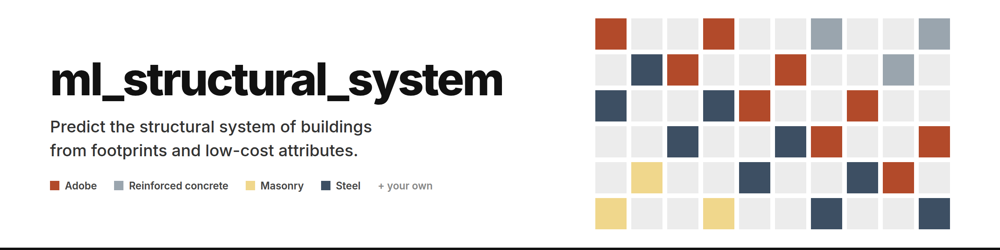
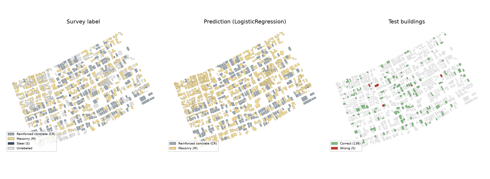

<p align="center"></p>

<p align="center">
  <a href="LICENSE"></a>
  <a href="https://github.com/GeomaticsCaminosUPM/ml_structural_system/actions/workflows/tests.yml"></a>
  <a href="https://geomaticscaminosupm.github.io/ml_structural_system/"></a>
  
</p>

Predict the structural system of individual buildings from their footprint, their neighbors and a few low-cost attributes such as height. You choose the classes (adobe, reinforced concrete, masonry, steel, or any other) in `config.yaml`.

The library is used in the paper *Estimating building structural systems from footprints: transferability of machine learning models across three Latin American cities*. Its experiments, data and figures are in [ml_structural_system_paper](https://github.com/GeomaticsCaminosUPM/ml_structural_system_paper), and its results can be explored with maps in a [Google Colab notebook](https://colab.research.google.com/github/GeomaticsCaminosUPM/ml_structural_system_paper/blob/main/paper_results.ipynb).



## What it does

1. **Split**: computes missing footprint features with [footprint_attributes](https://github.com/GeomaticsCaminosUPM/footprint_attributes), groups touching buildings into blocks, maps survey codes to classes and splits the labeled buildings into training, validation and test sets made of whole blocks.
2. **Train**: five models (logistic regression, balanced random forest, histogram gradient boosting, XGBoost, CatBoost). Each one gets a cross-validated search over hyperparameters and imbalance strategies (class weights, Synthetic Minority Over-sampling Technique (SMOTE), SMOTE followed by Tomek-link cleaning), then class-probability divisors tuned on the validation set to maximize macro F1.
3. **Test and assess**: macro F1, accuracy, Cohen's κ and the True Skill Statistic on the test set, agreement between models, bootstrap confidence intervals and feature importance.
4. **Predict**: applies the trained models to any buildings, surveyed or not.
5. **Check labels** (optional): flags surveyed buildings that the models contradict, on an interactive map for review.

XGBoost and CatBoost train on the GPU when CUDA is available. Their standard wheels already include GPU support on Linux and Windows.

## Installation

```bash
git clone https://github.com/GeomaticsCaminosUPM/ml_structural_system.git
cd ml_structural_system
uv sync
```

With pip: `pip install git+https://github.com/GeomaticsCaminosUPM/ml_structural_system.git`, or `pip install -r requirements.txt` for the tested versions. Python 3.12 or newer.

## Checking labels

Survey labels can be wrong. `mlss sanity` flags the surveyed buildings for which most models agree on a different class, and writes `sanity_suspects.csv` plus an interactive map (`sanity_check.html`). Each suspect shows every model's vote and a Street View link, and a reviewer can record the right class in the browser and export the corrections as CSV. The map needs the optional `sanity` extra:

```bash
uv sync --extra sanity        # or: pip install "ml-structural-system[sanity]"
mlss sanity --config config.yaml --data survey.gpkg
```

See [Checking labels](docs/guide/sanity.md).

## Quick start

Write a `config.yaml` ([example](examples/ensanche_quisquella/config.yaml)), then:

```bash
mlss split      --config config.yaml --output-dir splits
mlss preprocess --config config.yaml --input-dir splits --output-dir preprocessed_splits
mlss report     --config config.yaml --output-dir report    # train, test and assess
```

```python
from ml_structural_system.predict import predict

buildings = predict("config.yaml", "buildings.gpkg")   # one pred_<model> column per model
```

The input needs footprint polygons and, for training, the surveyed structural system. `height`, `year` and `roof_material` are used only if listed as features.

## Example

> [!WARNING]
> Until the peer-reviewed version of the paper is published, the footprints without a survey label in the example data are not the real ones. Their geometry, height and other attributes have been altered, so they look similar to the buildings of the area but do not match them. The 758 surveyed buildings are real.

`examples/ensanche_quisquella/` trains and tests three models on 758 surveyed buildings in Santo Domingo and draws the maps above. Its data are downloaded from the paper repository on the first run:

```bash
uv run python examples/ensanche_quisquella/run_example.py
```

## Documentation

[geomaticscaminosupm.github.io/ml_structural_system](https://geomaticscaminosupm.github.io/ml_structural_system/) covers the example, the configuration, how the method works and the API, plus a map of the paper's results. To preview it locally: `uv run mkdocs serve`.

## Tests

```bash
uv run pytest
```

## License

[European Union Public Licence v1.2 (EUPL-1.2)](LICENSE). The example data are the paper's Ensanche Quisqueya survey, downloaded from the paper repository, with the unlabeled footprints altered (see above).
