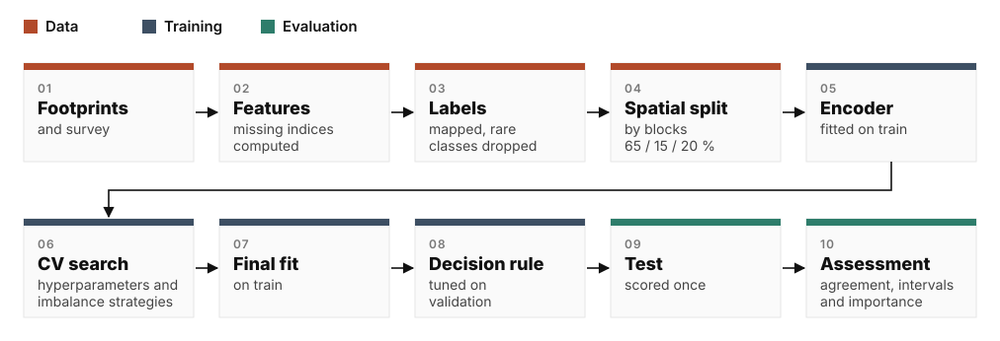

# How it works

{ .pipeline }

Each stage has its own page:

- [Spatial split](splitting.md): why neighbors must stay in the same partition.
- [Model selection and imbalance](training.md): the five models, the search and the imbalance strategies.
- [Decision rule](decision-rule.md): how minority classes get predicted at all.
- [Evaluation and feature importance](evaluation.md): the metrics, the baseline and the assessment.

The method is described in detail in the paper *Estimating building structural systems from footprints: transferability of machine learning models across three Latin American cities*.
