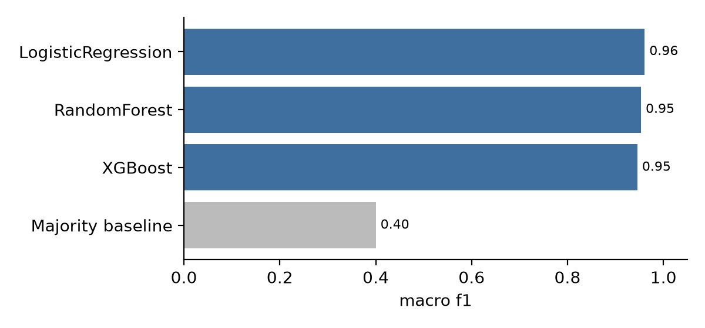
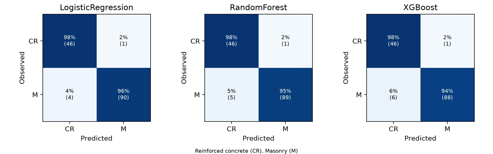
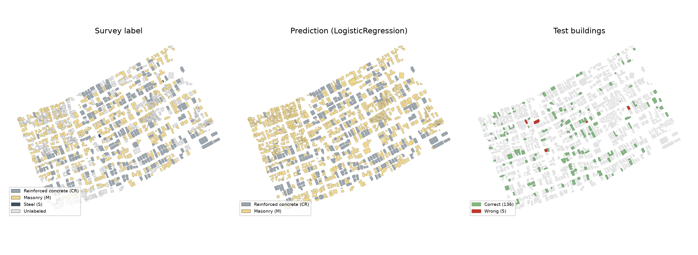

# Example: Ensanche Quisqueya

!!! warning "Altered footprints"
    Until the peer-reviewed version of the paper is published, the footprints without a survey label in the example data are not the real ones. Their geometry, height and other attributes have been altered, so they look similar to the buildings of the area but do not match them. The 758 surveyed buildings are real.

[`examples/ensanche_quisquella/`](https://github.com/GeomaticsCaminosUPM/ml_structural_system/tree/main/examples/ensanche_quisquella) trains and tests three fast models on a survey of 758 labeled buildings in Ensanche Quisqueya, Santo Domingo (Dominican Republic). It takes a few minutes on a laptop.

```bash
uv run python examples/ensanche_quisquella/run_example.py
```

The data are downloaded on the first run from the paper repository, [ml_structural_system_paper](https://github.com/GeomaticsCaminosUPM/ml_structural_system_paper), to `examples/ensanche_quisquella/data/`. The script keeps only 1,400 footprints with `id`, `height`, `year`, `roof_material` and `survey_structural_system`. Everything else is computed:

- the 23 footprint features, with footprint_attributes
- `code_quality`, from `year` with the Dominican seismic-code years (`code_type: dominican_republic`)
- the blocks of touching buildings

All settings are in [`config.yaml`](https://github.com/GeomaticsCaminosUPM/ml_structural_system/blob/main/examples/ensanche_quisquella/config.yaml).

## 1. Split, train and test

```python
mlss("split", "--config", CONFIG, "--output-dir", OUT / "splits")
mlss("preprocess", "--config", CONFIG, "--input-dir", OUT / "splits", "--output-dir", OUT / "preprocessed_splits")
mlss("report", "--config", CONFIG, "--output-dir", OUT / "report")   # train, test and assess
```

The two steel buildings are too few to learn from and are dropped. The split keeps whole blocks together:

| | Train | Validation | Test |
|---|---|---|---|
| Masonry (M) | 344 | 75 | 100 |
| Reinforced concrete (CR) | 154 | 35 | 46 |

## 2. Predict every building

```python
from ml_structural_system.predict import predict

buildings = predict(CONFIG, DATA)   # surveyed or not, one pred_<model> column per model
```

On the test buildings, `predict` gives exactly the scores of `mlss report`:

| Model | Macro F1 | Accuracy | Cohen's κ | True Skill Statistic |
|---|---|---|---|---|
| LogisticRegression | 0.961 | 0.965 | 0.921 | 0.936 |
| RandomForest | 0.953 | 0.957 | 0.906 | 0.926 |
| XGBoost | 0.946 | 0.950 | 0.891 | 0.915 |
| Majority baseline | 0.400 | 0.667 | 0.000 | 0.000 |





## 3. Maps

```python
plot_prediction_maps(buildings, test, "class", "LogisticRegression")  # best model
```

Left: survey labels. Center: predictions of the best model (logistic regression) for every footprint, including the unsurveyed ones. Right: test buildings, correct or wrong.



The predictions are saved to `output/predictions.gpkg` for use in a geographic information system (GIS).
