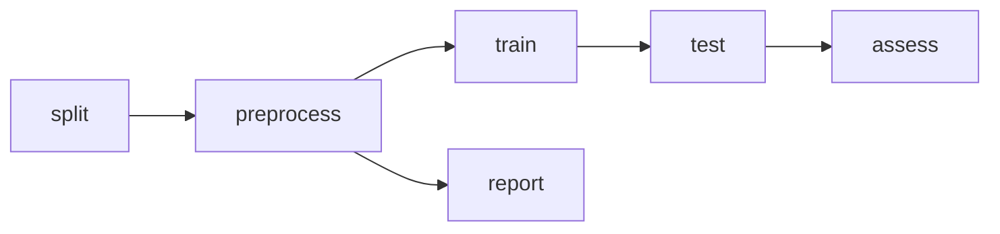

# Command line

All steps run through the `mlss` command (also `python -m ml_structural_system.cli`). Each takes `--config config.yaml`.

| Command | What it does |
|---|---|
| `mlss split` | Loads the raw data, computes missing features, maps labels and splits into training, validation and test |
| `mlss preprocess` | Fits the encoder on the training split and writes the encoded CSVs |
| `mlss train` | Cross-validated search, final fit and decision-rule tuning of every enabled model |
| `mlss test` | Scores every final model on the test split |
| `mlss assess` | Compares the models on the same buildings: agreement, confidence intervals, feature importance |
| `mlss report` | `train`, `test` and `assess` in one go, plus a summary |
| `mlss sanity` | Flags surveyed buildings that the models contradict and writes an interactive review map (needs the `sanity` extra) |

## `mlss split`

| Option | Default | Meaning |
|---|---|---|
| `--output-dir` | `splits` | Where to write `train_df`, `val_df` and `test_df` |
| `--test-size` | config | Override `preprocessing.data.test_size` |

## `mlss preprocess`

| Option | Default | Meaning |
|---|---|---|
| `--input-dir` | `splits` | Folder with the raw splits |
| `--output-dir` | `preprocessed_splits` | Where to write the encoded CSVs and the fitted encoders |
| `--no-scale` | | Keep numeric features on their original scale |

## `mlss train`

| Option | Meaning |
|---|---|
| `--final-only` | Skip cross-validation and redo only the final fit and the decision rule, reusing the best runs logged in MLflow |

## `mlss test`

No options beyond `--config`.

## `mlss report`

| Option | Default | Meaning |
|---|---|---|
| `--output-dir` | `report` | Where to write the report files |
| `--final-only` | | As in `mlss train` |

## `mlss assess`

| Option | Default | Meaning |
|---|---|---|
| `--data` | `dataset.test_path` | CSV with the features, and optionally the label |
| `--models` | enabled models | Models to compare |
| `--output` | | Write per-building results (each model's prediction, agreement, probabilities) to this CSV |
| `--gen-output` | | Write per-model generalizability statistics to this CSV |
| `--contested-threshold` | `0.5` | Agreement ratio under which a building is flagged as contested |
| `--gap-threshold` | `0.05` | Drop in macro F1 between cross-validation and test that flags low generalizability |
| `--explain` | | Also compute feature importance and the consensus ranking |
| `--no-mlflow` | | Do not log the assessment to MLflow |

## `mlss sanity`

Needs `uv sync --extra sanity`. See [Checking labels](sanity.md).

| Option | Default | Meaning |
|---|---|---|
| `--data` | `dataset.test_gpkg` | GeoPackage(s) with the surveyed buildings. Pass the whole survey to check every label |
| `--models` | enabled models | Models that vote |
| `--agreement-threshold` | `0.6` | Share of models that must agree on the other class |
| `--output` | `sanity_suspects.csv` | Suspects table |
| `--map-output` | `sanity_check.html` | Interactive map |
| `--no-map` | | Write only the CSV |

