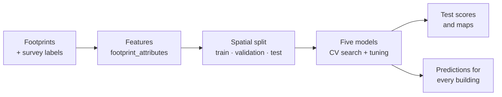

# ml_structural_system

**Predict the structural system of individual buildings** (adobe, reinforced concrete, masonry, steel...) from their footprint, their neighbors and a few low-cost geospatial attributes such as height.

It is the code of the paper *Estimating building structural systems from footprints: transferability of machine learning models across three Latin American cities*, packaged so it can be applied to any city with building footprints and a field survey.

-   :material-rocket-launch:{ .lg .middle } **Getting started**

    ---

    Install the package and run your first experiment in a few commands.

    [:octicons-arrow-right-24: Installation](getting-started/installation.md) · [Quickstart](getting-started/quickstart.md)

-   :material-book-open-variant:{ .lg .middle } **User guide**

    ---

    Data requirements, every configuration key, the `mlss` command line and the files it writes.

    [:octicons-arrow-right-24: Preparing data](guide/data.md)

-   :material-cog-outline:{ .lg .middle } **How it works**

    ---

    Spatially grouped splits, imbalance handling, the tuned decision rule and the evaluation.

    [:octicons-arrow-right-24: Overview](concepts/index.md)

-   :material-code-braces:{ .lg .middle } **API reference**

    ---

    Every module, class and function, generated from the docstrings.

    [:octicons-arrow-right-24: Reference](reference/index.md)

## What it does

- **Features from footprints**: plan-shape irregularity indices from five seismic codes and contact descriptors with neighboring buildings, computed with [footprint_attributes](https://github.com/GeomaticsCaminosUPM/footprint_attributes) when missing. Height, construction year and roof material are used when available.
- **Spatially grouped splits**: touching buildings form blocks, and each block goes entirely to training, validation or test, so neighbors never leak information.
- **Five classifiers**: logistic regression, balanced random forest, histogram gradient boosting, XGBoost and CatBoost, each with a cross-validated search over hyperparameters and imbalance strategies.
- **A tuned decision rule** that keeps minority classes from being swallowed by the majority class.
- **Assessment**: macro F1, accuracy, Cohen's κ, True Skill Statistic, bootstrap confidence intervals, agreement between models and feature importance.
- **GPU support**: XGBoost and CatBoost train on a CUDA GPU when one is available.

## Paper and results

The experiments, data and figures of the paper are in [ml_structural_system_paper](https://github.com/GeomaticsCaminosUPM/ml_structural_system_paper). Its results can be explored in the [interactive map](examples/paper-map.md) and in a [Google Colab notebook](https://colab.research.google.com/github/GeomaticsCaminosUPM/ml_structural_system_paper/blob/main/paper_results.ipynb).
